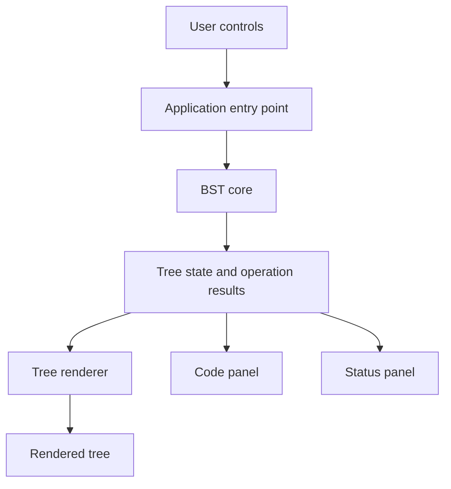

# Architecture

## Overview

This project is a client-side Vanilla JavaScript application served and built with Vite. Its modules are arranged to keep data-structure logic separate from rendering and interface concerns. The BST core, SVG renderer, and trace-driven browser interface are implemented.

## Folder responsibilities

- **`src/core/`** — Tree node representation and Binary Search Tree algorithms. Core modules should not read from or update the DOM.
- **`src/visualization/`** — `TreeRenderer` reads the BST node relationships and renders SVG nodes, edges, trace highlights, and operation animations. It owns layout and presentation only, not tree operations.
- **`src/ui/`** — `Controls` validates and serializes user actions, `CodePanel` displays the actual core source and highlights trace-tagged lines, and `StatusPanel` explains comparison and traversal events.
- **`src/utils/`** — `TraceAnimator` plays core events in order with an abortable delay between steps.
- **`src/styles/`** — Global stylesheet entry point, design tokens/theme, and component styles.
- **`src/assets/`** — Static assets used by the application.
- **`src/main.js`** — Browser entry point loaded by `index.html`; it composes the core, renderer, and UI modules.
- **`tests/`** — Tests for the core data structure and, as needed, other isolated modules.
- **`docs/`** — Project design and architecture documentation.

## Intended data flow

The core owns the tree's state and algorithms. The application invokes insert/delete synchronously to obtain the authoritative result and trace, then plays trace events through the UI and renderer. Clear is immediate and cancels in-flight playback. The renderer and UI panels display operation data; they do not implement or duplicate BST algorithms.

## Core API and trace events

`BinarySearchTree` stores finite numeric values in public `root` and `size` properties. It provides:

- `insert(value)` — returns `{ inserted, value, events }`; duplicate values are not inserted.
- `search(value)` — returns `{ found, node, value, events }`.
- `delete(value)` — returns `{ deleted, value, events }`. Two-child deletion uses the in-order successor.
- `clear()` — returns `{ cleared, previousSize, events }`.
- `inOrderTraversal()` — returns `{ values, events }`, with `values` in ascending order.

Each event is a plain object with a `type` and a stable `code` identifier, plus details relevant to the step, such as `value`, `nodeValue`, `direction`, or `replacementValue`. Inline `@trace` source markers associate event identifiers with lines of the real BST implementation. `CodePanel` reads the module through Vite's `?raw` import and derives its line map from those markers, avoiding a separate illustrative algorithm or duplicated line numbers. Markers cover insert, search, delete, clear, and in-order traversal events. Invalid non-finite values throw a `TypeError`.

## Technology choices

- **HTML and CSS** provide the document and presentation layer.
- **Vanilla JavaScript ES modules** provide native module boundaries without a UI framework.
- **Vite** serves the project during development and creates the production build.
- **Node.js built-in test runner** is used to run tests without an additional test framework.

Vite's `index.html` is the application entry document. Its module script loads `src/main.js`, which imports the stylesheet entry point. No server-side component is required for the planned client-side application.

## Current scope

`src/main.js` wires insert, delete, and clear controls to the core, delegates SVG output and tree layout to `TreeRenderer`, and sends operation trace events through `TraceAnimator`, `StatusPanel`, and `CodePanel`. Each step updates comparison text, LEFT/RIGHT status, source highlighting, and the current node/edge highlight. Search and in-order traversal are implemented and tested in the core but are not exposed as UI controls.

`TreeRenderer` positions nodes using actual parent/child relationships and keeps sibling subtree bounds separate. Successful insertions fade in; deletions fade out before the updated tree is drawn. Trace steps are separated by an abortable delay. Controls prevent concurrent operations; Clear remains available and cancels the active trace, pending renderer animation timer, and visual state.

The desktop layout places code and tree panels side-by-side; below the mobile breakpoint they stack. Large or skewed trees remain horizontally scrollable. Reduced-motion preferences shorten CSS effects. The theme is implemented locally without external fonts, copyrighted game art, or runtime services.

## Verification

`npm test` uses the Node.js built-in test runner. Tests cover BST insertion, search, duplicates, leaf/one-child/two-child deletion, missing values, clearing, negative and invalid inputs; SVG layout for balanced, skewed, and irregular trees; and UI source mapping, status synchronization, rapid actions, and cancellation. `npm run build` verifies the Vite production bundle.

`TreeRenderer.render(root, { events, highlightValue, traversal, animate, onComplete })` draws a tree and optional operation state. `updateTrace(event)` updates active node and edge highlights between draws; `reset(root)` cancels pending animation work. `calculateTreeLayout(root)` is exported to test tree geometry independently. The renderer does not mutate the tree or implement BST algorithms.
